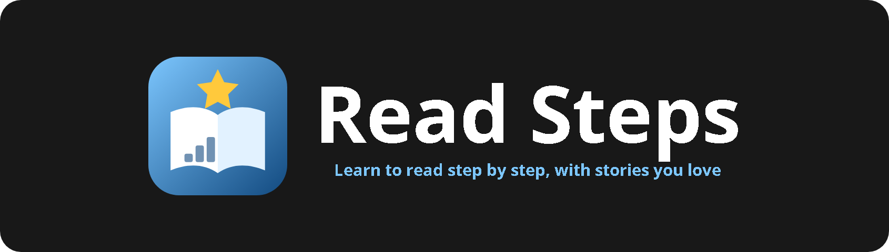
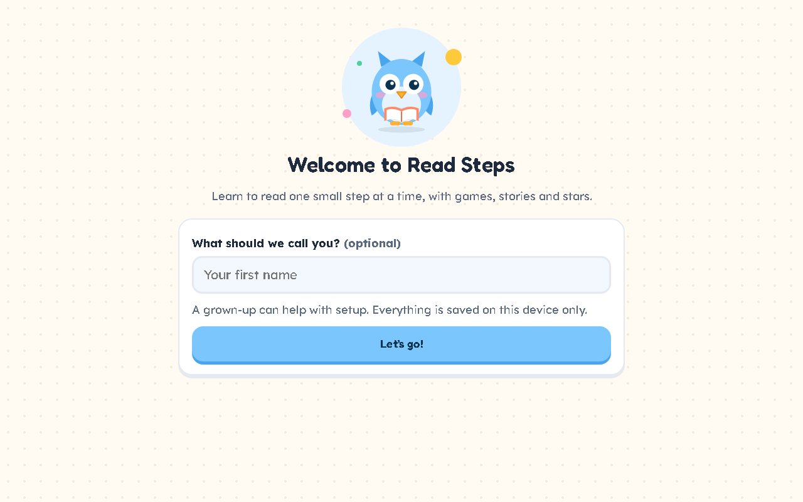

<p align="center"></p>

<p align="center">    </p>

Read Steps teaches reading one step at a time, in the style of music-learning apps. It starts with a short adaptive placement test to find your reading level, then builds a learning path of phonics, tricky words, stories picked to match your interests, and quizzes. The level keeps adapting as you improve.

<p align="center"></p>

## Features

- Onboarding for name, age group, interests (animals, space, dinosaurs, footy and more) and goals
- Adaptive 12-question placement test covering letters, sounds, sight words, blends, sentences and short passages
- Levels from Pre-reader to Level 10, loosely mapped to phonics phases and Lexile-style bands
- Learning path map: phonics → tricky words → story → quiz, with stars, XP, streaks and a daily goal
- 32 original stories; tap any word to hear it, or use read-along highlighting
- "I'll read" mode uses speech recognition to flag missed words (where supported)
- Automatic level changes plus a retakeable "Check my level" test

## Getting started

No build step and no dependencies. Clone the repo and open `index.html`, or serve the folder locally:

```bash
git clone https://github.com/Squidly1408/read-steps.git
cd read-steps
python -m http.server 8834
```

Then visit http://localhost:8834.

## Project structure

| File | Purpose |
|---|---|
| `index.html` | App shell |
| `app.js` | Placement test, path, reader and progress logic |
| `content.js` | Stories, word lists and quiz content |
| `styles.css` | Styles |
| `assets/` | Logo and README images |

## Built with

HTML, CSS, JavaScript (Speech Synthesis and Speech Recognition APIs), localStorage

## Limitations

- Phonics plays whole words rather than isolated letter sounds (browser voices can't say sounds reliably)
- Read-aloud checking only works in Chrome, Edge or Safari and can be inaccurate with young voices
- Progress is stored on this device and browser only

## License

Released under the [MIT License](LICENSE).
